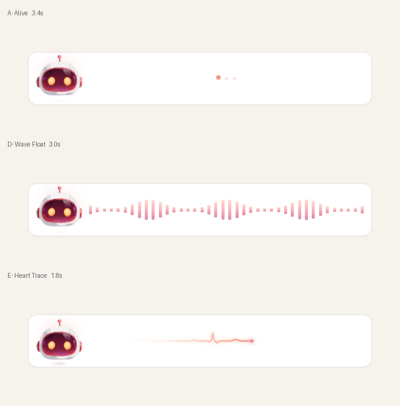
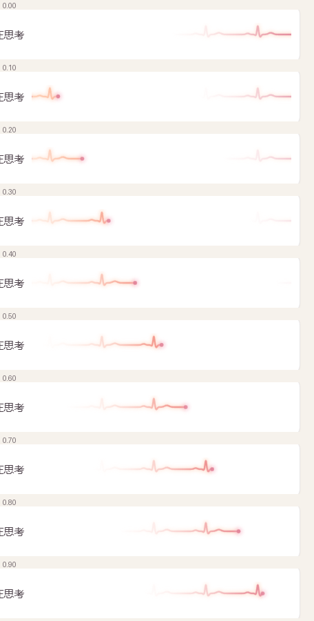

# Working Motion · AI Agent 工作中动效

AI Agent 在**思考 / 读取**时，对话气泡里播放的循环微动效。机器人头负责"活着"的呼吸感，右侧轨道负责"在工作"的进度感，两者共用一个节拍。

纯 HTML + CSS + 原生 JS，零运行时依赖，机器人头 SVG 已内联，`index.html` 单文件即可直接打开。

## 在线预览

https://xdean-designer.github.io/agent/

## 三种方案

| | 方案 | 右侧形态 | 头部 | 主循环 |
|---|---|---|---|---|
| **A** | Alive | 三点跑马，0.85s 一轮 | 悬浮 7.5%，无压缩 | 3.4s |
| **D** | Wave Float | 声波阶梯，每 8px 一根 | 悬浮 8.3%，无压缩 | 3.0s |
| **E** | Heart Trace | 单点拖尾心电，46% 条宽 | 蹦跶 12% + 浮 3.3% | 1.8s |

点击卡片可切换下方的对话现场预览，参数表会跟随高亮当前方案。



## E · 单点拖尾心电

这是三种里唯一带"心跳"的方案。一条光点沿心电波形从左走到右，身后拖出渐隐的痕迹——**条上没有常驻的底槽**，波形只在光点经过时才存在。



实现要点：

**波形用数学函数生成**，不是手绘路径。P / Q / R / S / T 五个高斯峰叠加，改参数就能改形态：

```js
v += 0.13 * gaussPx(at(0.155), 3.4);    // P
v += -0.11 * gaussPx(at(0.312), 1.7);   // Q
v += 1.00 * gaussPx(at(R_POS), 1.55);   // R
v += -0.27 * gaussPx(at(0.398), 1.9);   // S
v += 0.20 * gaussPx(at(0.600), 4.8);    // T
```

**拖尾靠遮罩窗口切出来**，两个矩形在横向平移，尾端越过左缘时波形从右侧续上，所以循环接缝不跳帧：

```html
<mask id="m..." maskUnits="userSpaceOnUse">
  <rect class="tA" width="L" fill="url(#fade)"/>
  <rect class="tB" width="L" fill="url(#fade)"/>
</mask>
```

渐变为 `0 → .16 → .52 → .88 → 1`，得到自然衰减而不是截断的硬头。光点在接缝的 5% 区间内淡出再淡入，避免从右缘瞬移到左缘。

**命中 R 峰时头部轻压**。光点扫过每个 R 峰，头部压缩 10.6%、影子收缩、光晕扩散，一次循环 3 次。

**拍数固定为 3**，卡片（条 276px）与对话行（条 230px）虽然宽度不同，但都是 3 拍 / 1.67Hz，节奏不会分裂。

## 文件

```
index.html          构建产物，单文件可直接打开（机器人头已内联）
src/app.html        模板源码，改这里
assets/robot.svg    机器人头矢量素材
tools/              构建、截图、逐帧渲染、动效度量脚本
docs/               README 用预览图
```

改完 `src/app.html` 后运行构建：

```bash
node tools/build.mjs
```

构建会把 `assets/robot.svg` 内联成 data URI，并断言没有残留的外部引用。

## 验证脚本

脚本依赖本机 Chrome，路径写在文件开头。

```bash
node tools/smoke.mjs        # 冒烟：默认方案、气泡、报错
node tools/e2e.mjs          # 交互：切卡、参数表联动、重播衔接、帧率
node tools/check-final.mjs  # 对比度、移动端溢出、reduced-motion
node tools/breakpoints.mjs  # 1440 → 390 逐档布局检查
node tools/tempo-check.mjs  # 卡片与对话行节拍是否一致

node tools/frames.mjs variant=E   # 逐帧渲染（60fps，供出 GIF/视频）
python tools/seam-check.py        # 循环接缝帧差
python tools/squash.py            # 头部压缩幅度
python tools/amplitude.py         # 悬浮行程
```

实测：接缝帧差 0.024，普通相邻帧均值 0.125（接缝比常态平滑约 5 倍）；头部压缩 10.6%；121fps；对比度全部 ≥ 5.41:1。

## 接入方式

- `index.html` 整个页面可以直接放进 iframe，或把 `makeBubble()` + `Scene` 类单独摘出来嵌到现有气泡组件里。
- 尊重 `prefers-reduced-motion`：命中时自动停在首帧并给出静态形态。
- 承载元素需有明确宽度，波形与拍数按容器宽度自适应。

## 配色

马卡龙玫红系，按亮到暗：

```css
--p-cream:#FFDCCB;  --p-apricot:#FFC7A8;  --p-blush:#FBC9CE;
--p-rose:#F7B3C4;   --p-coral:#F39287;    --p-berry:#E2879B;
```

文字与背景对比度均满足 WCAG AA。

## License

MIT
